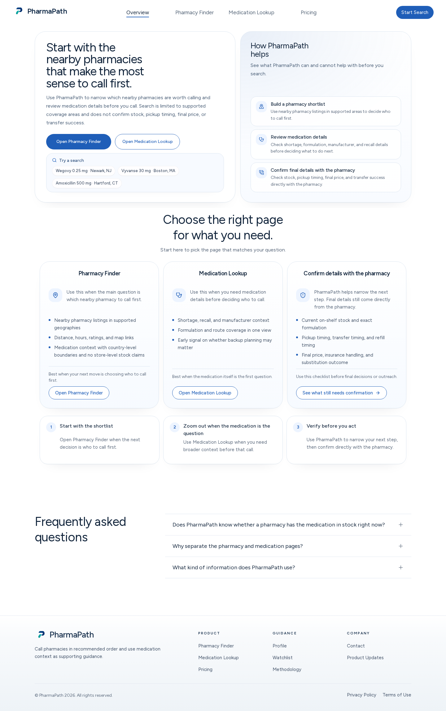

# PharmaPath

PharmaPath was retired on October 11, 2026. Its public website preserves the project overview; interactive services are no longer available.

**[Visit PharmaPath](https://pharmapath.org)** · [Using the preserved site](setup.md) · [Help](faq.md)

  

## What remains available

You can view the preserved overview. Product actions show a retirement notice. Pharmacy search, medication lookup, sign-in, watchlists, account settings, notifications, and form submissions are unavailable.

The overview describes the former product. It does not provide current medication information, live pharmacy inventory, or medical advice. Contact pharmacies directly about availability, price, insurance, and pickup timing.

## Help

- [Using the preserved site](setup.md)
- [User guide](product-guide.md)
- [Help and FAQ](faq.md)
- [Privacy and your data](security-and-privacy.md)

[Report a website or guide problem](https://github.com/dylanwlim/pharmapath-docs/issues/new?template=bug.yml) · [Feedback guidelines](CONTRIBUTING.md) · [Community conduct](CODE_OF_CONDUCT.md)
